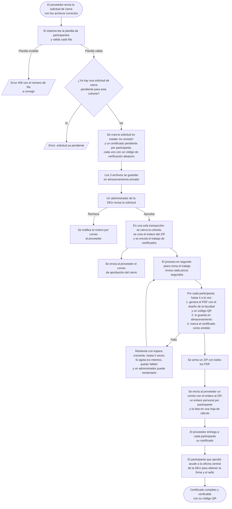

# Cierre de cohorte y generación de certificados

Este documento describe lo que hace el sistema desde que un proveedor envía una solicitud de cierre de cohorte con sus tres archivos (participantes aprobados, comprobantes y encuesta) hasta que los participantes pueden validar su certificado.

## Diagrama de flujo

## Explicación del flujo

1. **Envío de la solicitud.** El proveedor adjunta tres archivos: la planilla de participantes aprobados (con la plantilla XLSX que ofrece el sistema), los comprobantes y la encuesta. Antes de crear la solicitud, el sistema valida la planilla fila por fila. Si algo está mal, indica el número de fila que se debe corregir.
2. **Revisión.** La solicitud queda "en revisión" y un administrador de la DEU la revisa. Si la rechaza, el proveedor recibe por correo el motivo. Si la aprueba, la cohorte queda cerrada.
3. **Generación de certificados.** Al aprobar, el sistema genera en segundo plano un PDF por cada participante aprobado, con el diseño de la facultad que avaló el curso. Esto no demora la aprobación: el administrador no espera a que terminen los PDF.
4. **Entrega.** Al terminar, el proveedor recibe un correo con todo lo necesario para entregar los certificados.

## Preguntas frecuentes

### Una vez cerrado el curso, ¿cuánto tarda la generación de certificados?

Normalmente unos pocos minutos, que pueden llegar a unos 10 en cohortes muy numerosas. Si hay una falla temporal, el sistema reintenta solo. Para dar una respuesta sencilla al usuario: **hasta 24 horas**. Si pasa ese tiempo sin recibir el correo, debe contactar a la DEU para que reintenten el proceso.

### ¿Dónde puede el proveedor ver los certificados?

En el **correo electrónico** que recibe la persona que envió la solicitud de cierre, con el asunto "Certificados de la cohorte disponibles". Ese correo incluye:

* Un enlace para descargar **todos los certificados en un ZIP**.
* Un **enlace personal por participante**, donde se verifica y descarga su certificado.
* La lista de participantes con su enlace, adjunta en una hoja de cálculo (`participantes.xlsx`).

El sistema no tiene por ahora una pantalla donde el proveedor consulte los certificados después. Por eso conviene que conserve ese correo.

### ¿Recibirán los participantes un enlace a sus correos con su certificado?

**No.** El correo con los enlaces lo recibe solo el proveedor, que se encarga de hacerlos llegar a los participantes. La columna `Correo` de la planilla es opcional y por ahora solo se guarda, sin usarse para enviar nada.

### ¿Qué pasos deben seguir los participantes que aprobaron para validar su certificado?

1. Recibir su certificado (PDF o enlace personal) de parte del proveedor.
2. Acudir a la **oficina central de la DEU** para obtener la **firma y el sello** del certificado.

### ¿Para qué sirve el código QR del certificado?

Lleva a una página pública de verificación de la DEU. Ahí cualquier persona (por ejemplo, un empleador) puede comprobar que el certificado es auténtico. La página muestra:

* El nombre del participante y su cédula parcialmente oculta.
* El curso, su duración, las fechas y la facultad.
* La fecha de emisión.
* Un botón para descargar el PDF.

Si el código no existe o el certificado fue revocado, la página indica que el certificado **no es válido**.
