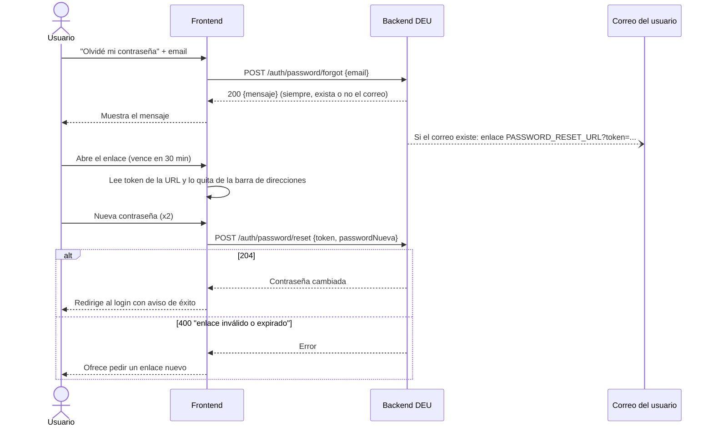

# Cambio y restablecimiento de contraseña (guía para frontend)

El backend tiene tres endpoints de contraseña en `auth`. Esta guía explica qué pantallas necesita el frontend y cómo usar cada endpoint.

| Necesidad del usuario | Pantalla del frontend | Endpoint |
|---|---|---|
| Olvidó su contraseña y no puede entrar | **Olvidé mi contraseña** (enlazada desde el login) | `POST /auth/password/forgot` |
| Abrió el enlace que le llegó por correo | **Restablecer contraseña** (la ruta configurada en `PASSWORD_RESET_URL`) | `POST /auth/password/reset` |
| Tiene sesión y quiere cambiar su contraseña | **Cambiar contraseña** (dentro del perfil) | `PUT /auth/password` |

## Flujo de recuperación



### 1. Pantalla "Olvidé mi contraseña"

1. Pide el email y llama a `POST /auth/password/forgot`.
2. Si la respuesta es **200**, muestra el campo `mensaje` tal como llega:

   > Si el correo está registrado, recibirás un enlace para restablecer tu contraseña.

3. **Nunca** digas "ese correo no existe" ni cambies el mensaje según el resultado. El backend responde lo mismo exista o no el correo, para que nadie pueda averiguar qué correos están registrados.
4. Un **400** solo indica que el email está mal formado. Conviene validar el formato en el cliente antes de enviar.

```js
const res = await fetch(`${API_URL}/auth/password/forgot`, {
  method: 'POST',
  headers: { 'Content-Type': 'application/json' },
  body: JSON.stringify({ email: 'ana.perez@example.com' }),
});
if (res.ok) {
  const { mensaje } = await res.json();
  mostrarAviso(mensaje);
}
```

### 2. Página "Restablecer contraseña"

Es la página a la que apunta `PASSWORD_RESET_URL`. El correo trae el enlace `PASSWORD_RESET_URL?token=<token>`.

1. **Lee `token` de la query string.** Si falta, muestra un error con un enlace a "Olvidé mi contraseña".
2. **Quita el token de la URL** apenas lo leas, con `history.replaceState`. Así no queda en el historial, en capturas de pantalla ni en el header `Referer`.
3. Pide la nueva contraseña **dos veces**. La confirmación solo se compara en el frontend; el backend recibe una sola.
4. Valida en el cliente que tenga **al menos 8 caracteres**, la misma regla que aplica el backend.
5. Llama a `POST /auth/password/reset`:
   - **204:** la contraseña cambió. Redirige al login con un aviso de éxito. Este endpoint **no** inicia sesión.
   - **400 `enlace inválido o expirado`:** el enlace venció, ya se usó o es inválido. Ofrece volver a "Olvidé mi contraseña" para pedir uno nuevo.
   - **400 `validation failed`:** falta el token o la contraseña es muy corta.

```js
const params = new URLSearchParams(window.location.search);
const token = params.get('token');
window.history.replaceState(null, '', window.location.pathname);

const res = await fetch(`${API_URL}/auth/password/reset`, {
  method: 'POST',
  headers: { 'Content-Type': 'application/json' },
  body: JSON.stringify({ token, passwordNueva }),
});
if (res.status === 204) {
  irAlLogin({ aviso: 'Tu contraseña fue actualizada. Ya puedes iniciar sesión.' });
} else {
  const { error } = await res.json();
  mostrarError(error);
}
```

**Qué no hacer con el token:**

- No lo guardes en `localStorage`, `sessionStorage` ni en cookies. Solo vive en memoria mientras el usuario está en la página.
- No lo envíes como `Authorization: Bearer`. No es un token de sesión y el backend lo rechaza.
- No lo mandes a herramientas de analítica ni a logs del cliente.

## Cambio de contraseña con sesión iniciada

En el perfil, pide la contraseña actual y la nueva (dos veces) y llama a `PUT /auth/password` con el token de sesión:

```js
const res = await fetch(`${API_URL}/auth/password`, {
  method: 'PUT',
  headers: {
    'Content-Type': 'application/json',
    Authorization: `Bearer ${tokenDeSesion}`,
  },
  body: JSON.stringify({ passwordActual, passwordNueva }),
});
```

| Respuesta | Qué significa | Qué hacer |
|---|---|---|
| `204` | La contraseña cambió. | Mostrar éxito. La sesión actual sigue siendo válida, así que no hace falta volver a iniciar sesión. |
| `401` con `error: "contraseña actual incorrecta"` | La contraseña actual no coincide. | Marcar el campo "contraseña actual". |
| `401` con otro `error` | La sesión venció o el token es inválido. | Mandar al login. |
| `400` | Faltan campos o la nueva contraseña tiene menos de 8 caracteres. | Mostrar el error de validación. |

## Referencia de endpoints

Todas las respuestas de error tienen la forma `{"error": "<mensaje>"}`. Un `500` siempre trae un mensaje genérico.

### `PUT /auth/password`

- **Auth:** `Authorization: Bearer <token de sesión>`
- **Body:** `{"passwordActual": "claveActual123", "passwordNueva": "claveNueva456"}`

| Código | `error` |
|---|---|
| `204` | (sin cuerpo) |
| `400` | `validation failed` o `invalid request body` |
| `401` | `contraseña actual incorrecta` |
| `401` | `invalid or expired authorization token` (sesión inválida o vencida) |

### `POST /auth/password/forgot`

- **Auth:** ninguna
- **Body:** `{"email": "ana.perez@example.com"}`

| Código | Cuerpo |
|---|---|
| `200` | `{"mensaje": "Si el correo está registrado, recibirás un enlace para restablecer tu contraseña."}` |
| `400` | `{"error": "validation failed"}` o `{"error": "invalid request body"}` |

### `POST /auth/password/reset`

- **Auth:** ninguna
- **Body:** `{"token": "<token del enlace>", "passwordNueva": "claveNueva456"}`

| Código | `error` |
|---|---|
| `204` | (sin cuerpo) |
| `400` | `enlace inválido o expirado` |
| `400` | `validation failed` o `invalid request body` |

## Reglas del enlace

- **Vence a los 30 minutos.**
- **Sirve una sola vez.** Deja de funcionar en cuanto la contraseña cambia, por cualquier vía: con este mismo enlace, con otro enlace o desde el perfil.
- **Pedir un enlace nuevo no invalida los anteriores.** Mientras la contraseña no cambie y no hayan vencido, todos funcionan. El primero que se use invalida al resto.
- **No es un token de sesión.** No sirve para llamar a ningún otro endpoint.

## Configuración

- **`PASSWORD_RESET_URL`** (backend): URL completa de la página "Restablecer contraseña", por ejemplo `https://formacion.extension.ucv.ve/restablecer-contrasena`. El backend le agrega `?token=...`.
  - Es **una sola URL**. Aunque los dos frontends (grupos y formación) tengan la pantalla "Olvidé mi contraseña", el enlace del correo siempre lleva al frontend configurado. Ese frontend debe tener la página de restablecimiento.
  - Si la URL ya tiene query string, el backend conserva sus parámetros y agrega `token`.
- **`ALLOWED_ORIGINS`** (backend): el origen de cada frontend que llame a estos endpoints debe estar en la lista, o el navegador bloqueará las peticiones por CORS.

## Probar con `curl`

```bash
# Pedir el enlace
curl -i -X POST "$API_URL/auth/password/forgot" \
  -H 'Content-Type: application/json' \
  -d '{"email": "ana.perez@example.com"}'

# Restablecer con el token del correo
curl -i -X POST "$API_URL/auth/password/reset" \
  -H 'Content-Type: application/json' \
  -d '{"token": "<token>", "passwordNueva": "claveNueva456"}'

# Cambiar con sesión iniciada
curl -i -X PUT "$API_URL/auth/password" \
  -H 'Content-Type: application/json' \
  -H "Authorization: Bearer $TOKEN" \
  -d '{"passwordActual": "claveActual123", "passwordNueva": "claveNueva456"}'
```
