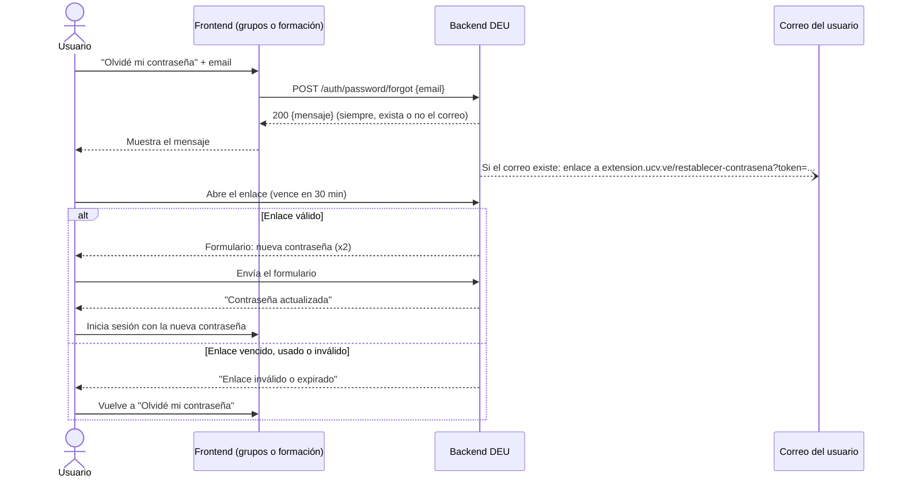

# Cambio y restablecimiento de contraseña (guía para frontend)

El backend tiene tres endpoints de contraseña en `auth` y sirve, además, la página a la que lleva el enlace de recuperación. Esta guía explica qué pantallas necesita cada frontend y cómo usar cada endpoint.

| Necesidad del usuario | Dónde se resuelve | Endpoint |
|---|---|---|
| Olvidó su contraseña y no puede entrar | **Olvidé mi contraseña**, en cada frontend (enlazada desde el login) | `POST /auth/password/forgot` |
| Abrió el enlace que le llegó por correo | **Restablecer contraseña**, servida por el backend en `https://extension.ucv.ve/restablecer-contrasena`. **No hay que construirla en el frontend.** | `GET` y `POST /restablecer-contrasena` |
| Tiene sesión y quiere cambiar su contraseña | **Cambiar contraseña**, en cada frontend (dentro del perfil) | `PUT /auth/password` |

Como la página del enlace la sirve el backend en el dominio de la DEU, la recuperación funciona igual para usuarios de grupos y de formación, y ningún sistema depende del otro.

## Flujo de recuperación



### Pantalla "Olvidé mi contraseña" (frontend)

1. Pide el email y llama a `POST /auth/password/forgot`.
2. Si la respuesta es **200**, muestra el campo `mensaje` tal como llega:

   > Si el correo está registrado, recibirás un enlace para restablecer tu contraseña.

3. **Nunca** digas "ese correo no existe" ni cambies el mensaje según el resultado. El backend responde lo mismo exista o no el correo, para que nadie pueda averiguar qué correos están registrados.
4. Un **400** solo indica que el email está mal formado. Conviene validar el formato en el cliente antes de enviar.

```js
const res = await fetch(`${API_URL}/auth/password/forgot`, {
  method: 'POST',
  headers: { 'Content-Type': 'application/json' },
  body: JSON.stringify({ email: 'ana.perez@example.com' }),
});
if (res.ok) {
  const { mensaje } = await res.json();
  mostrarAviso(mensaje);
}
```

### Página "Restablecer contraseña" (backend)

No requiere trabajo en el frontend. Se documenta aquí para saber qué verá el usuario:

- **`GET /restablecer-contrasena?token=...`:** valida el enlace antes de mostrar nada.
  - Si es válido, muestra un formulario con la nueva contraseña y su confirmación.
  - Si no, muestra "Enlace inválido o expirado" y le indica que pida uno nuevo desde "Olvidé mi contraseña".
- **`POST /restablecer-contrasena`:** procesa el formulario.
  - Si las contraseñas no coinciden o tienen menos de 8 caracteres, vuelve a mostrar el formulario con el error.
  - Si todo está bien, muestra "Contraseña actualizada" y le indica que inicie sesión en grupos o formación.
- Es HTML sin JavaScript, con headers que evitan que el token quede en caché, se filtre en el `Referer` o se cargue dentro de un iframe.
- **No inicia sesión.** Después de restablecer, el usuario entra por el login de su sistema.

Si en el futuro un frontend quiere su propia pantalla de restablecimiento, puede usar el endpoint JSON `POST /auth/password/reset` (ver la referencia). En ese caso, `PASSWORD_RESET_URL` tendría que apuntar a esa pantalla.

## Cambio de contraseña con sesión iniciada (frontend)

En el perfil, pide la contraseña actual y la nueva (dos veces) y llama a `PUT /auth/password` con el token de sesión:

```js
const res = await fetch(`${API_URL}/auth/password`, {
  method: 'PUT',
  headers: {
    'Content-Type': 'application/json',
    Authorization: `Bearer ${tokenDeSesion}`,
  },
  body: JSON.stringify({ passwordActual, passwordNueva }),
});
```

| Respuesta | Qué significa | Qué hacer |
|---|---|---|
| `204` | La contraseña cambió. | Mostrar éxito. La sesión actual sigue siendo válida, así que no hace falta volver a iniciar sesión. |
| `401` con `error: "contraseña actual incorrecta"` | La contraseña actual no coincide. | Marcar el campo "contraseña actual". |
| `401` con otro `error` | La sesión venció o el token es inválido. | Mandar al login. |
| `400` | Faltan campos o la nueva contraseña tiene menos de 8 caracteres. | Mostrar el error de validación. |

## Referencia de endpoints

Todas las respuestas de error de la API tienen la forma `{"error": "<mensaje>"}`. Un `500` siempre trae un mensaje genérico.

### `PUT /auth/password`

- **Auth:** `Authorization: Bearer <token de sesión>`
- **Body:** `{"passwordActual": "claveActual123", "passwordNueva": "claveNueva456"}`

| Código | `error` |
|---|---|
| `204` | (sin cuerpo) |
| `400` | `validation failed` o `invalid request body` |
| `401` | `contraseña actual incorrecta` |
| `401` | `invalid or expired authorization token` (sesión inválida o vencida) |

### `POST /auth/password/forgot`

- **Auth:** ninguna
- **Body:** `{"email": "ana.perez@example.com"}`

| Código | Cuerpo |
|---|---|
| `200` | `{"mensaje": "Si el correo está registrado, recibirás un enlace para restablecer tu contraseña."}` |
| `400` | `{"error": "validation failed"}` o `{"error": "invalid request body"}` |

### `POST /auth/password/reset` (opcional)

La usa una pantalla de restablecimiento propia de un frontend. Con la página del backend no hace falta.

- **Auth:** ninguna
- **Body:** `{"token": "<token del enlace>", "passwordNueva": "claveNueva456"}`

| Código | `error` |
|---|---|
| `204` | (sin cuerpo) |
| `400` | `enlace inválido o expirado` |
| `400` | `validation failed` o `invalid request body` |

## Reglas del enlace

- **Vence a los 30 minutos.**
- **Sirve una sola vez.** Deja de funcionar en cuanto la contraseña cambia, por cualquier vía: con este mismo enlace, con otro enlace o desde el perfil.
- **Pedir un enlace nuevo no invalida los anteriores.** Mientras la contraseña no cambie y no hayan vencido, todos funcionan. El primero que se use invalida al resto.
- **No es un token de sesión.** No sirve para llamar a ningún otro endpoint.

## Configuración

- **`PASSWORD_RESET_URL`** (backend): URL de la página a la que lleva el correo. En producción es `https://extension.ucv.ve/restablecer-contrasena`. El backend le agrega `?token=...`.
- **Traefik:** el router `backend-password-reset` de `docker-compose.prod.yml` envía `extension.ucv.ve/restablecer-contrasena` al backend. El resto de `extension.ucv.ve` sigue en la landing, igual que con `/certificados` y `/files`.
- **`ALLOWED_ORIGINS`** (backend): el origen de cada frontend que llame a `/auth/password/forgot` o `/auth/password` debe estar en la lista, o el navegador bloqueará las peticiones por CORS. La página del backend no lo necesita, porque envía el formulario a su propia ruta.

## Probar con `curl`

```bash
# Pedir el enlace
curl -i -X POST "$API_URL/auth/password/forgot" \
  -H 'Content-Type: application/json' \
  -d '{"email": "ana.perez@example.com"}'

# Abrir la página sin token: debe mostrar "Enlace inválido o expirado" (400)
curl -i "https://extension.ucv.ve/restablecer-contrasena"

# Cambiar con sesión iniciada
curl -i -X PUT "$API_URL/auth/password" \
  -H 'Content-Type: application/json' \
  -H "Authorization: Bearer $TOKEN" \
  -d '{"passwordActual": "claveActual123", "passwordNueva": "claveNueva456"}'
```
